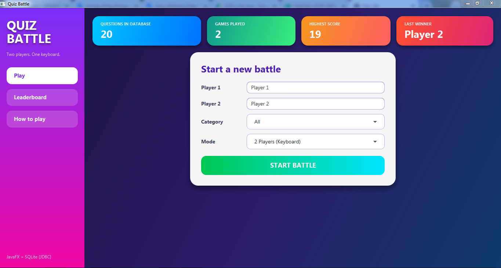
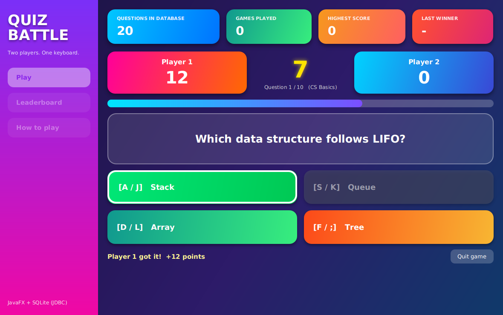
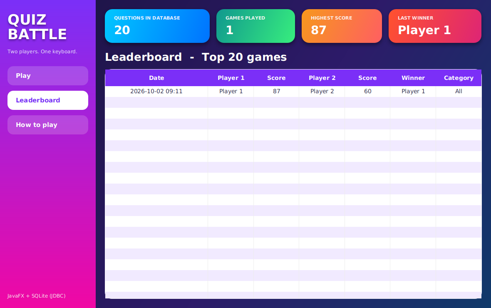

# Quiz Battle

A colourful **two-player quiz game** for the desktop. Two players share one keyboard and race to answer multiple-choice questions.
Built with **Java, JavaFX and SQLite (JDBC)** as an *OOPS with Java* micro project (event handling, MVC, DAO).

## Demo

[Watch the demo video](demo/QuizBattle_Demo.mp4)

| Dashboard | Game | Leaderboard |
| --- | --- | --- |
|  |  |  |

## Features

- Colourful dashboard: gradient sidebar and four statistic cards (questions in database, games played, highest score, last winner)
- **2-player mode** on one keyboard, and a **Solo mode** (mouse click or keys)
- 20 sample questions in 4 categories (Java, DBMS, Aptitude, CS Basics), stored in SQLite and shuffled for every game
- 10 questions per game, 10 second timer with a progress bar that turns red in the last 3 seconds
- Faster correct answer = more points (6 to 15); wrong answer = -2 points and lock-out for that question
- Winner announcement, results saved in the database, Leaderboard table (top 20 games)
- All colours and gradients in a separate JavaFX CSS file (`quiz.css`)

## How to play

| | Player 1 | Player 2 |
| --- | --- | --- |
| Option 1 to 4 | `A` `S` `D` `F` | `J` `K` `L` `;` |

1. Enter the names, choose a category and a mode, press **START BATTLE**.
2. Press the key of the option you think is correct before your friend does.
3. After the last question the winner is shown and the result is saved.

## Event handling used

| Event | Where |
| --- | --- |
| `KEY_PRESSED` (scene event filter) | Both players answer with the keyboard |
| Mouse click | Choosing an option in Solo mode |
| Mouse enter / exit | Glow effect on option buttons |
| Action events | Buttons, ComboBox, menu |
| `Timeline` / `PauseTransition` | Countdown timer, short pause between questions |

## Run

**Requirements:** JDK 8 with JavaFX (Oracle JDK 8 includes JavaFX) and the SQLite JDBC jar in `lib/` (see [lib/README.md](lib/README.md)).

Windows:

```
run.bat
```

Linux / macOS:

```
./run.sh
```

**Java 11 or newer:** JavaFX is not bundled, so download the JavaFX SDK and run

```
set PATH_TO_FX=C:\path\to\javafx-sdk\lib
javac --module-path %PATH_TO_FX% --add-modules javafx.controls -cp "lib\*" -d out src\*.java
java  --module-path %PATH_TO_FX% --add-modules javafx.controls -cp "out;lib\*" QuizApp
```

The database file `quizbattle.db` and the 20 sample questions are created automatically on the first run.

## Project structure (MVC + DAO)

```
QuizBattle
|-- src
|   |-- QuizApp.java         View        JavaFX dashboard
|   |-- QuizController.java  Controller  key/mouse events, timer, game rules
|   |-- Question.java        Model
|   |-- ScoreRow.java        Model
|   |-- Db.java              JDBC connection + table creation
|   |-- QuestionDAO.java     JDBC for the questions table (+ seed questions)
|   `-- ScoreDAO.java        JDBC for the scores table + dashboard stats
|-- quiz.css                 all colours and gradients
|-- lib                      sqlite-jdbc jar goes here
|-- screenshots, demo
`-- run.bat, compile.bat, run.sh
```

### Database

```sql
questions(id, category, question, a, b, c, d, correct)   -- 'a' is the correct option in the seed data
scores(id, p1, p2, s1, s2, winner, category, played_on)
```

To add your own questions, add rows to `questions` (the options are shuffled at game time, so put the **correct answer in column `a`** and keep `correct = 0`).

## Future scope

- Screen to add, edit and delete questions
- Adjustable timer and difficulty levels
- Sound effects, player profiles and score charts
- Online two-player mode

## Author

**Nishanthini M** - [@25243060-creator](https://github.com/25243060-creator)

Licensed under the [MIT License](LICENSE).
